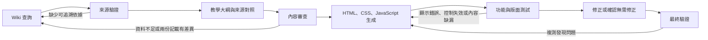
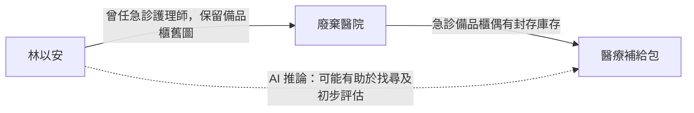

# 第十週簡報的 Loop / Graph

- **內容回查**。以 MCP 讀取事件與人物頁後，回查匯入 HTML 的「事件經過」與「背景故事」。兩份記載不足以判定是否為同一批病患的同一次轉移，因此第 3 頁保留兩種描述。第 8 頁把林以安可能有助於查找物資的推論獨立呈現。
- **功能回查**。重現問題時，記下瀏覽器、視窗大小和操作步驟，回到對應的 HTML、CSS 或 JavaScript 修改，並重跑檢查。測試環境的問題另外記錄。
- **交付證據**。大綱和每頁來源可查閱[簡報大綱](slides-outline.md)，實際測試、修正與尚待驗證項目以[驗證紀錄](validation.md)為準。

## 第 8 頁的案例 Graph

實線是原文資料支持的事實，虛線是教學中標示的 AI 推論。現有來源未交代林以安是否回收或運送特定補給批次。
